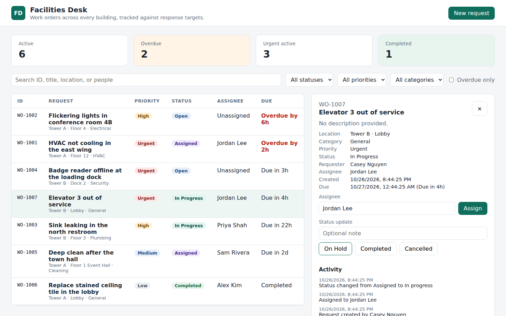

# Facilities Desk: PRD-to-PR Demo

A small, generic facilities work-order tracker used to show Factory taking a
request from a Linear issue to a reviewed, QA-verified pull request with no
human steps in between.

> **Demo identity:** Facilities Desk is a fictional application built for a CBRE
> conversation. It uses no CBRE assets, data, systems, or customer information.
> All data is generated in memory at startup.



## What the app does

Facilities teams log work orders (HVAC, electrical, plumbing, cleaning,
security, general), assign technicians, and track each request against a
response target set by its priority.

| Priority | Response target |
| --- | --- |
| Urgent | 4 hours |
| High | 24 hours |
| Medium | 72 hours |
| Low | 7 days |

A work order is overdue when it is still active after its due time. It is at
risk when it is still active, at least 75% of its response window has passed,
and it is not yet overdue (for example, an Urgent order created at 09:00 is at
risk from 12:00 through 13:00). Status changes follow a fixed workflow:

- **Open → Assigned** happens only through the assign action.
- **Assigned → In progress**, and **In progress ⇄ On hold**.
- **In progress → Completed**.
- Any active work order can move to **Cancelled**.

Completed and cancelled work orders are closed: they cannot be reassigned or
moved again, and they are never overdue or at risk.

## API

| Method | Path | Purpose |
| --- | --- | --- |
| `GET` | `/api/work-orders` | List work orders. Optional filters: `status`, `priority`, `category`, `overdue`, `atRisk`, `q` (search ID, title, location, people) |
| `POST` | `/api/work-orders` | Create a work order (`title`, `location`, `category`, `priority`, `requester`, optional `description`) |
| `GET` | `/api/work-orders/{id}` | Get one work order with its activity history |
| `POST` | `/api/work-orders/{id}/assign` | Assign or reassign a technician (`assignee`) |
| `POST` | `/api/work-orders/{id}/status` | Change status (`status`, optional `note`) |
| `GET` | `/api/work-orders/summary` | Active, overdue, at-risk, urgent, and per-status counts |
| `GET` | `/actuator/health` | Health check |

Errors use RFC 9457 problem details: `400` for validation (with an `errors`
map per field), `404` for an unknown ID, and `409` for a status change the
workflow does not allow.

## Run locally

Requirements: Java 21 and Maven 3.8+.

```bash
mvn --batch-mode test          # 41 unit and API tests
mvn spring-boot:run            # http://localhost:8080
```

Set `facilities.demo-data=false` to start with an empty list.

With Docker:

```bash
docker build -t facilities-desk .
docker run --rm -p 8080:8080 facilities-desk
```

## Project layout

```text
src/main/java/com/example/facilities/
  workorder/            Domain, workflow rules, in-memory store, sample data
  workorder/api/        REST controller, request/response records, error handling
src/main/resources/static/
  index.html, app.js, styles.css   Single-page UI (no build step)
src/test/java/...       Service rules (JUnit) and HTTP contract tests (MockMvc)
docs/pipeline.md        The agentic PRD-to-PR pipeline this repo demonstrates
```

## The pipeline

This repository is the target of a Factory pipeline:

```text
Linear issue ─▶ PRD ─▶ Planner ─▶ Dev ─▶ Code Review + E2E QA ─▶ PR Babysitter ─▶ green PR
```

See [`docs/pipeline.md`](docs/pipeline.md) for every stage, its trigger, the
Linear signals it uses, and its guardrails.
