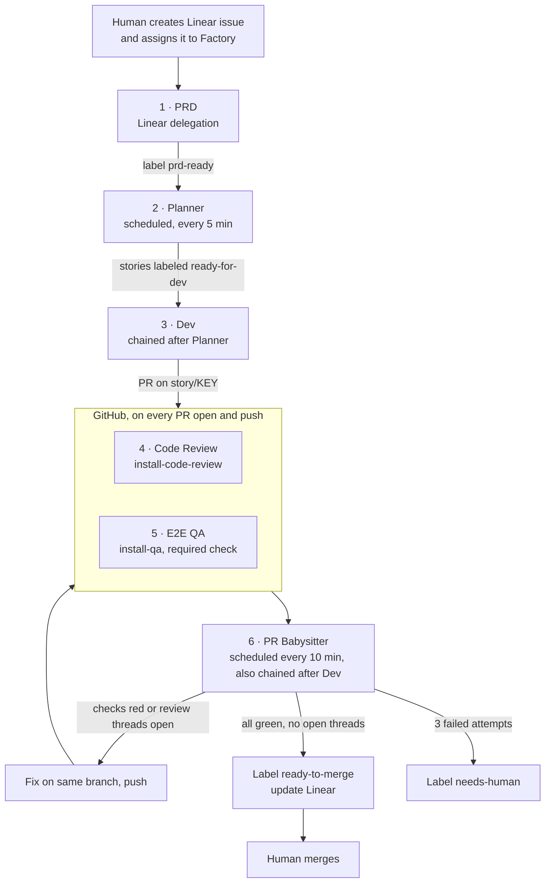

# PRD-to-PR pipeline

This repository demonstrates Factory driving a request from a Linear issue to a
pull request that has passed code review and end-to-end QA, with no human
steps until the final merge.

## Stages

| # | Stage | Runs as | Trigger | Reads | Writes |
| --- | --- | --- | --- | --- | --- |
| 1 | PRD | Linear delegation (issue assigned to Factory) | Assignment or `@Factory` mention | Issue title, description, comments | `## Structured PRD` comment, `prd-ready` label |
| 2 | Planner | Scheduled automation | Every 5 minutes | Issues labeled `prd-ready` without stories | Story sub-issues with `## Implementation Plan`, `ready-for-dev` label |
| 3 | Dev | Chained automation | After each Planner run | Stories labeled `ready-for-dev` without `pr-open` | Branch `story/<KEY>`, tests, pull request, `## Pull Request` comment, `pr-open` label |
| 4 | Code Review | GitHub Action | PR opened, reopened, and every push | Pull request diff | Inline review comments |
| 5 | E2E QA | GitHub Action, required check | PR opened, reopened, and every push | Pull request diff, running app | One sticky QA report comment, evidence artifacts |
| 6 | PR Babysitter | Scheduled automation, also chained after Dev | Every 10 minutes | Open `story/*` PRs, checks, review threads | Fix commits, thread replies, `## Fix Loop #n` comment, final labels |

Every stage loads one skill, `cbre-demo-prd-to-pr`, and runs only its own
section. The stage logic lives in this repository, versioned with the code.

## Why a PR Babysitter, not a return to Dev

- Automation chains cannot loop, so the fix cycle restarts from GitHub
  events instead: a fix push reruns Code Review and QA automatically.
- One pull request keeps its review threads, QA report, and commit history.
- Fixes see only the failing check and the open threads, so they stay small.
- The Dev stage stays simple: one story, one pull request.
- The built-in PR Babysitter only drives failing CI to green. Review comments
  do not fail a check, so this babysitter handles both.

## Babysitter rules on each run

| PR state | Action |
| --- | --- |
| Checks still running | Skip until the next run |
| QA or tests red, or review threads unresolved | Fix on the same branch, reply to and resolve each addressed thread, push, add `fixing`, post `## Fix Loop #n` in Linear |
| All checks green and no unresolved threads | Add `ready-to-merge`, remove `fixing`, move the Linear story forward |
| Three fix attempts without going green | Add `needs-human`, stop, explain in Linear |

## Linear labels

| Label | Set by | Meaning |
| --- | --- | --- |
| `prd-ready` | PRD | Structured PRD posted |
| `ready-for-dev` | Planner | Story has an implementation plan |
| `pr-open` | Dev | Pull request exists for the story |
| `fixing` | PR Babysitter | A fix is in progress |
| `ready-to-merge` | PR Babysitter | Review and QA are clean |
| `needs-human` | PR Babysitter | Automatic fixing stopped |
| `demo-seed-defect` | Presenter (opt-in) | Dev ships one known defect first so the fix loop is visible |

## Guardrails

- Nothing merges automatically. A human merges the green pull request.
- Tests are never skipped, disabled, or deleted to make a check pass.
- Every stage checks Linear and GitHub state before acting, so reruns are safe.
- Fixes stay within the story's implementation plan.
- `demo-seed-defect` is visible on the Linear story and recorded in a Linear
  comment. It is never used outside a demo.

## Setup status

| Component | Status |
| --- | --- |
| Demo application and tests | Done |
| Code Review workflow (`install-code-review`) | Done |
| E2E QA workflow and skills (`install-qa`) | Done |
| Build, unit test, and container workflow (`ci.yml`) | Done |
| `cbre-demo-prd-to-pr` skill | Planned |
| Linear project, labels, delegation | Planned |
| Planner, Dev, and PR Babysitter automations | Planned |
